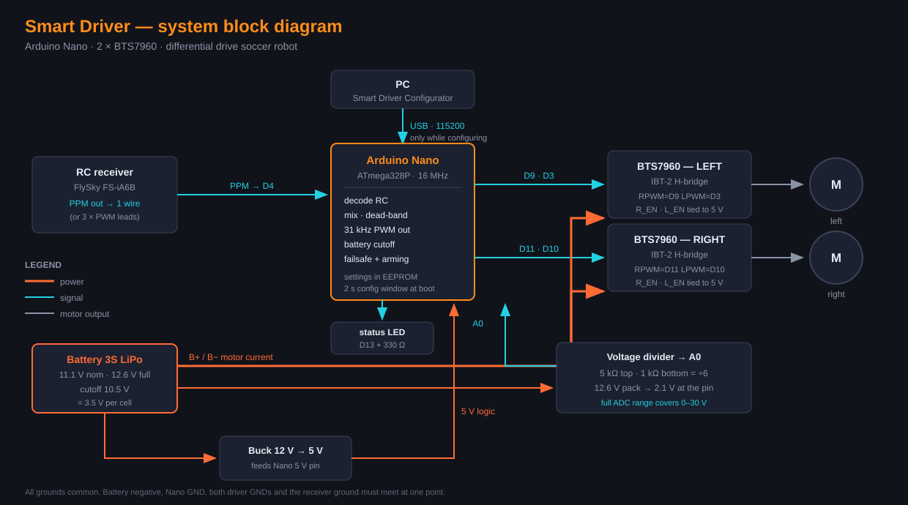
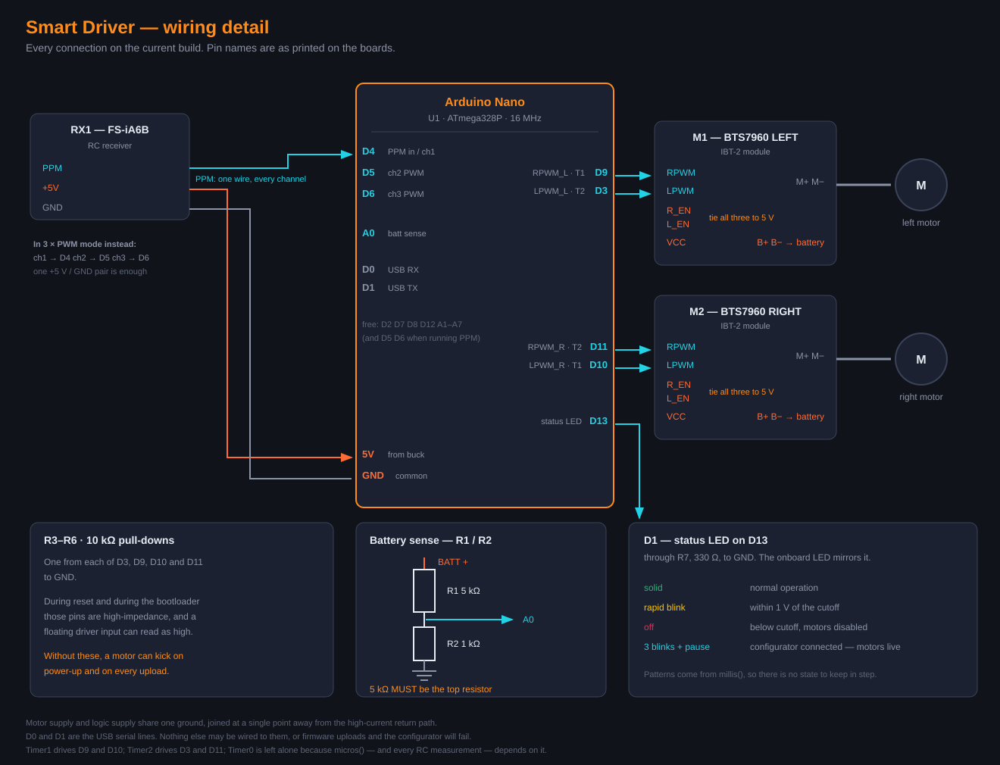

# Smart Driver — RC Motor Driver for Arduino Nano + BTS7960

A complete two-motor RC driver for a differential-drive robot. Build the
circuit, flash one `.hex` file, and tune everything from a Windows app —
no programming, no Arduino IDE, no recompiling.



| | |
|---|---|
| **Drive** | two brushed DC motors, independent speed and direction |
| **Radio** | 3 × PWM servo leads, **or** a single PPM wire (up to 8 channels) |
| **PWM carrier** | 31 kHz — above hearing, so the motors run silently |
| **Response** | motors start the instant the stick leaves centre, no dead spot |
| **Mixing** | transmitter-side, or arcade mixing done in the firmware |
| **Speed limit** | a third channel scales the top speed live |
| **Battery** | voltage monitoring with a debounced low-voltage cutoff |
| **Failsafe** | stops on lost signal, bad values, or a missing throttle |
| **Settings** | stored on the board, edited over USB with the configurator |

Everything adjustable is adjustable **without reflashing**.

---

## What you need

### Parts

| Ref | Part | Value / model | Notes |
|---|---|---|---|
| **U1** | Arduino Nano | ATmega328P, 16 MHz, 5 V | a CH340 clone is fine and cheap |
| **M1, M2** | BTS7960 H-bridge module | "IBT-2", 43 A | one per motor |
| **RX1** | RC receiver | FlySky FS-iA6B or similar | PPM output, or 3 servo leads |
| **BT1** | Battery | 3S LiPo, 11.1 V | 12.6 V full, 10.5 V cutoff |
| — | Buck converter | 12 V → 5 V, 1 A or more | powers the logic |
| **R1** | Resistor | **5 kΩ** | battery divider, **top** |
| **R2** | Resistor | **1 kΩ** | battery divider, bottom |
| **R3–R6** | Resistor × 4 | 10 kΩ | pull-downs — **do not skip these** |
| **R7** | Resistor | 330 Ω | LED series resistor |
| **D1** | LED | 3 mm or 5 mm | status indicator |
| — | Motors | brushed DC, 12 V | |

### Tools

- A Windows PC
- A USB cable for the Nano
- A multimeter (only for calibrating the battery monitor)
- A soldering iron

---

## Step 1 — Build the circuit



### Pin connections

| Nano pin | Connects to | Purpose |
|---|---|---|
| **D4** | receiver PPM signal | RC input (or channel 1 in PWM mode) |
| **D5** | receiver ch2 signal | *only in 3 × PWM mode* |
| **D6** | receiver ch3 signal | *only in 3 × PWM mode* |
| **D9** | M1 `RPWM` | left motor forward |
| **D3** | M1 `LPWM` | left motor reverse |
| **D11** | M2 `RPWM` | right motor forward |
| **D10** | M2 `LPWM` | right motor reverse |
| **D13** | R7 → D1 → GND | status LED |
| **A0** | junction of R1 and R2 | battery voltage sense |
| **5V** | buck converter output | logic power in |
| **GND** | common ground | |

**Leave D0 and D1 alone.** They are the USB serial lines. Anything
connected to them will break firmware uploads and the configurator.

### On each BTS7960 module

| Module pin | Connects to |
|---|---|
| `RPWM`, `LPWM` | the Nano, per the table above |
| `R_EN`, `L_EN`, `VCC` | **all three to 5 V** |
| `GND` | common ground |
| `B+`, `B−` | battery, directly — this carries the motor current |
| `M+`, `M−` | the motor |

### The four pull-down resistors

Fit one 10 kΩ resistor from each of **D3, D9, D10 and D11** to ground.

These are not optional. While the board is resetting or running its
bootloader, those four pins are floating, and a floating input on a
BTS7960 can read as "on". Without the pull-downs, **a motor can lurch
every time you power up or upload firmware.**

### The battery divider

```
BATT + ──┬── R1 (5 kΩ) ──┬── A0 on the Nano
         │               │
       battery          R2 (1 kΩ)
         │               │
BATT − ──┴───────────────┴── GND
```

> ⚠️ **The 5 kΩ must be the top resistor**, between the battery and A0.
> Wire it the other way round and a 12 V pack puts over 10 V onto A0,
> which destroys the pin. This is the only mistake on this build that
> cannot be undone.

### Grounding

Battery negative, both driver grounds, the Nano's GND and the receiver
ground must **all meet at one point**, and that point should be away from
the thick motor wires. Motors pull tens of amps when they stall, and if
the logic ground returns through the motor ground wire, the voltage drop
shows up as noise on the Nano.

---

## Step 2 — Install the USB driver

**Almost every cheap Arduino Nano uses a CH340 USB chip, and Windows does
not always have the driver.** If you plug the Nano in and no COM port
appears, this is why.

### How to check first

Plug the Nano in, then open **Device Manager** (press `Win + X`, choose
Device Manager).

- **Working:** under *Ports (COM & LPT)* you see something like
  `USB-SERIAL CH340 (COM3)`. **Skip to Step 3.**
- **Driver missing:** under *Other devices* you see a yellow warning
  triangle on `USB2.0-Serial` or `Unknown device`. Install the driver
  below.

### Installing the CH340 driver

1. Download the installer from WCH, the chip maker:
   **<https://www.wch-ic.com/downloads/CH341SER_EXE.html>**
   (ZIP version: <https://www.wch.cn/download/CH341SER_ZIP.html>)
2. Unzip it if needed and run **`CH341SER.EXE`**.
3. Click **INSTALL**. Wait for "The driver is successfully pre-installed".
4. **Unplug the Nano and plug it back in.**
5. Check Device Manager again — you should now see a COM port.

If you prefer a guided walkthrough with pictures, SparkFun has a good one:
<https://learn.sparkfun.com/tutorials/how-to-install-ch340-drivers>

### If your board uses a different chip

| Chip on the board | Driver |
|---|---|
| **CH340 / CH341** | the link above |
| **CP2102** (Silicon Labs) | <https://www.silabs.com/developer-tools/usb-to-uart-bridge-vcp-drivers> |
| **FT232** (FTDI) | <https://ftdichip.com/drivers/vcp-drivers/> |
| **ATmega16U2** (genuine Arduino) | no driver needed on Windows 10/11 |

### Troubleshooting

| Problem | Fix |
|---|---|
| No COM port at all | Try a different USB cable. Many cheap cables are charge-only and carry no data. |
| Port appears then vanishes | Faulty cable or an underpowered USB hub. Plug directly into the PC. |
| Driver install fails | Right-click the installer → **Run as administrator**. |
| Still a yellow triangle | In Device Manager, right-click the device → *Update driver* → *Browse my computer* → point it at the unzipped driver folder. |

---

## Step 3 — Install the configurator

**No installation needed.** Download
[`app/SmartDriverConfigurator.exe`](app/SmartDriverConfigurator.exe) and
run it.

It is a single self-contained file — the Python runtime, the serial
library, and `avrdude` for flashing are all inside it. Nothing else needs
to be on the PC. Put it on a USB stick if you like.

> **Windows SmartScreen may warn you** the first time, because the file is
> not code-signed (signing requires a paid certificate). Click
> **More info → Run anyway**.

First launch takes about 3 seconds while it unpacks itself. Later launches
are the same — that is the cost of being a single file.

---

## Step 4 — Flash the firmware

1. Download [`firmware/smart-driver-v3.hex`](firmware/smart-driver-v3.hex).
2. Open the configurator and go to the **Firmware** page (the ↓ icon).
3. **Do not press Connect.** Flashing and the serial connection cannot
   share the port. If you are already connected, press **DISCONNECT** first.
4. Click **Browse** and select the `.hex` file. The app checks it and
   shows its size against the Nano's 30 KB of usable space.
5. Choose your COM port.
6. Set the baud rate:
   - **Auto** — tries 115200, then falls back to 57600. Start here.
   - **57600** — most clone Nanos (old bootloader). Try this if Auto fails.
   - **115200** — genuine or newer boards.
7. Click **UPLOAD**. Progress appears in the log.

When it finishes, the status LED on D13 should light up solid.

**If flashing fails** with `programmer is not responding` or a sync error,
it is almost always the baud rate — set it to **57600** explicitly and try
again.

---

## Step 5 — Set it up

> 🔴 **Put the robot on a stand with the wheels off the ground.**
> The motors stay live the entire time the configurator is connected.

Work through it in this order. Each step is easier to check than the one
after it.

### 5.1 Connect

Open the configurator, pick the COM port, click **CONNECT**.

The app resets the board, which opens a 2-second window where the firmware
listens for the PC. All your settings load automatically. The status LED
changes to **three blinks and a pause** to show it is connected.

### 5.2 Check the receiver is heard

Go to **RC / Calibration** and move the sticks. The channel bars should
move.

If they do not, and the frame counter is not climbing, the receiver signal
is not reaching D4 — check the wire, check the receiver is bound to your
transmitter, and check the receiver shares a ground with the Nano.

### 5.3 Calibrate the radio

Still on **RC / Calibration**:

1. Centre the sticks, capture **Mid**.
2. Move every stick to both extremes, capture **Min** and **Max**.
3. Click **SAVE RC CALIBRATION SETTINGS**.

### 5.4 Set the protocol and mixing

Go to **Channels & Direction**:

- **Receiver protocol** — `PPM` for a single-wire connection, or
  `3 × PWM` for three servo leads.
- **Channel count** — `3` if you are using a third channel as a speed
  limit, otherwise `2`.
- **Mixing** — `Transmitter` if your radio already mixes two sticks into
  left and right. `Firmware` for one-stick arcade control.

Now watch the **outL / outR** bars while moving the sticks, and fix the
directions using **Reverse left**, **Reverse right** and **Swap motors**.

Do this **before connecting the motors**. It is far easier to reason about
on screen than with a robot jumping around, and no rewiring is needed —
the firmware has flags for every combination.

Click **SAVE CHANNELS SETTINGS**.

### 5.5 Connect motors and battery

Disconnect the configurator. Connect `M+`/`M−` and then `B+`/`B−`.

Power up and check each wheel turns the right way. If not, go back to 5.4.

### 5.6 Calibrate the battery monitor

Connect again and go to **Battery**:

1. Measure the actual pack voltage with a multimeter.
2. Type that number into the calibration box — the app works out the
   scale factor for you.
3. Set **Cutoff voltage** to `10500` mV for a 3S LiPo (3.5 V per cell).
4. Tick **Enable battery monitoring**.
5. Click **SAVE BATTERY SETTINGS**.

This is last on purpose. Battery monitoring ships **disabled**, because an
uncalibrated scale would read the wrong voltage and cut your motors
immediately.

### 5.7 Tune the feel

On the ground now. Go to **Tuning** and adjust **Start margin**:

- Motor buzzes but does not turn at the smallest stick movement → **raise** it
- Robot lurches instead of starting gently → **lower** it

Click **SAVE TUNING SETTINGS**.

**Done.** Disconnect, and the robot runs on its own.

---

## The status LED

The LED on D13 tells you what the board is doing:

| Pattern | Meaning |
|---|---|
| **Solid** | Normal operation |
| **Fast blinking** | Battery within 1 V of the cutoff — stop soon |
| **Off** | Battery below cutoff, motors disabled |
| **3 blinks, then a pause** | Configurator connected — **motors are live** |

---

## Common problems

| Symptom | Cause and fix |
|---|---|
| No COM port in the app | USB driver — see Step 2. Also try another cable. |
| Flashing fails | Set the baud rate to **57600**. Disconnect before flashing. |
| App will not connect | Something else is holding the port (Arduino IDE's Serial Monitor is the usual culprit). Close it. |
| Nothing moves, LED solid | Connect the app and check **RC / Calibration**. If the frame counter is not climbing, the receiver is not being heard. |
| Nothing moves, LED off | Battery below cutoff, or no power. |
| Robot will not arm | In 3-channel mode, the firmware refuses to drive if it cannot see channel 3. Check that channel. |
| Robot creeps with sticks released | Redo the radio calibration (5.3). Centre is in the wrong place. |
| A motor jumps on power-up | A missing pull-down resistor. Check R3–R6. |
| Motors whine audibly | PWM frequency is not 31 kHz. On **Tuning**, set it back — and reset **Driver dead counts** to **40** when you do. |
| Wheels spin the wrong way | Use the Reverse and Swap settings (5.4), not rewiring. |

---

## Full configurator manual

Every page, every setting, what it does and when to change it:

### **[→ docs/USER-MANUAL.md](docs/USER-MANUAL.md)**

---

## What is in this repository

```
README.md                         this guide
docs/
  USER-MANUAL.md                  every configurator setting explained
  images/
    schematic.svg                 the wiring diagram
    block-diagram.svg             how the system fits together
app/
  SmartDriverConfigurator.exe     the Windows configurator (12 MB)
firmware/
  smart-driver-v3.hex             firmware v3, ready to flash
```

Firmware v3, built for the ATmega328P. Uses 12134 bytes of 30720 (39 %)
and 620 bytes of RAM.

## Safety

- **Wheels off the ground** whenever the configurator is connected.
- **Check the battery divider** before applying power — 5 kΩ on top.
- LiPo batteries can catch fire if over-discharged. The cutoff helps, but
  it is not a substitute for charging properly and not leaving packs flat.
- Motors can pull tens of amps on stall. Use wire that is thick enough and
  fuse the battery.
